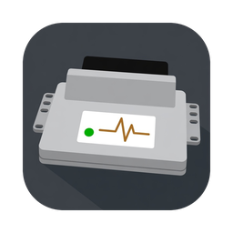

<p align="center"></p>

# MacAutoDiag Lite

Нативное приложение для macOS (Swift/SwiftUI) для ЭБУ ВАЗ Январь 5.1 и 7.2: просмотр и редактирование прошивок, контрольная сумма, диагностика по K-line, запись и разбор логов, чтение и запись блока через загрузчик, эмулятор ЭБУ, исполняющий настоящую прошивку.

## Запуск

```sh
tools/run-app.sh                                                 # приложение
tools/run-app.sh -- firmware/j5/j5v05l19/J5V05L19.BIN --diag     # диагностика на эмуляторе
swift test                                                       # тесты
```

Нужны macOS 14+ и Xcode или Swift 6. Для работы с машиной — кабель KKL на FTDI (FT232R).

## Что умеет

| Область | Функции |
|---|---|
| Прошивки | открытие `.bin`, определение ЭБУ и версии ПО, hex, сравнение двух прошивок, контрольная сумма |
| Таблицы | описания всех серийных J5 и I205DO54, импорт карт ChipTuningPRO, правка, 3D, отмена |
| Диагностика | живые данные, напряжения на входах, коды с описанием, снимок блока, карта обучения смеси, ручное управление реле и ХХ |
| Логи | запись CSV, метки, разбор по ячейкам таблицы, графики |
| Чтение и запись блока | Январь 5.1, встроенный загрузчик C509, +12 В на вывод 47: прошивка, EEPROM, отвязка иммобилайзера |
| Эмулятор | C509 и периферия; двигатель крутится, датчики задаются ползунками |

Прошивки на датчике давления, например J5LS, здесь не поставляются. Если такая прошивка стоит в вашем блоке, программа покажет её расширенный кадр и откроет карту `.j5`, которая у вас есть (`docs/j5ls.md`).

## Что проверено на железе

| Функция | На живом блоке | Только в эмуляторе |
|---|---|---|
| Диагностика, логи, снимок | J5LS | серийные прошивки Января 5.1; 7.2 — частично |
| Чтение и запись через загрузчик | один блок 2112-1411020-41 | остальные блоки |
| Отвязка иммобилайзера | нет | да |

## Отказ от ответственности

Программа предоставляется **как есть, без каких-либо гарантий**. Вход в загрузчик, чтение и запись могут необратимо вывести блок из строя или стереть прошивку. На блоке с защитой от копирования это может случиться уже при чтении (`docs/flashing.md`). Ответственность за блок, двигатель и последствия несёте вы. Сделайте резервную копию и по возможности используйте запасной блок. Не управляйте программой за рулём.

## Прошивки в репозитории

`firmware/j5` и `firmware/j72` — серийные образы для тестов и обучения, каталог — `firmware/README.md`. Права на них принадлежат их правообладателям, лицензия этого репозитория на них не распространяется. Если вы правообладатель и хотите убрать образ, напишите в Issues.

## Лицензия

Код программы — MIT, см. `LICENSE`. Образы прошивок и сторонние материалы под неё не подпадают, см. `THIRD_PARTY_NOTICES.md`.

## Документация

| Файл | О чём |
|---|---|
| `docs/first-log.md` | первая запись лога |
| `docs/diagnostic-guide.md` | поиск причины неисправности по шагам |
| `docs/tutorial/` | уроки с картинками: диагностика на эмуляторе, разбор лога, разбор прошивки, чтение и запись блока |
| `docs/flashing.md` | чтение и запись блока |
| `docs/j5-hardware.md` | распиновка, каналы АЦП, стенд |
| `docs/kwp2000-j5.md` | протокол диагностики |
| `docs/j5-reverse-notes.md`, `docs/j72-reverse-notes.md` | устройство прошивок |
| `docs/ctp-maps.md` | карты ChipTuningPRO |
| `docs/j5ls.md`, `docs/j5ls-dad-tuning.md` | J5LS: кадр и настройка на ДАД |
| `docs/emulator.md`, `docs/agent.md`, `docs/plan-logging.md`, `docs/sources.md` | эмулятор, доступ для агента (MCP), логи, источники |
