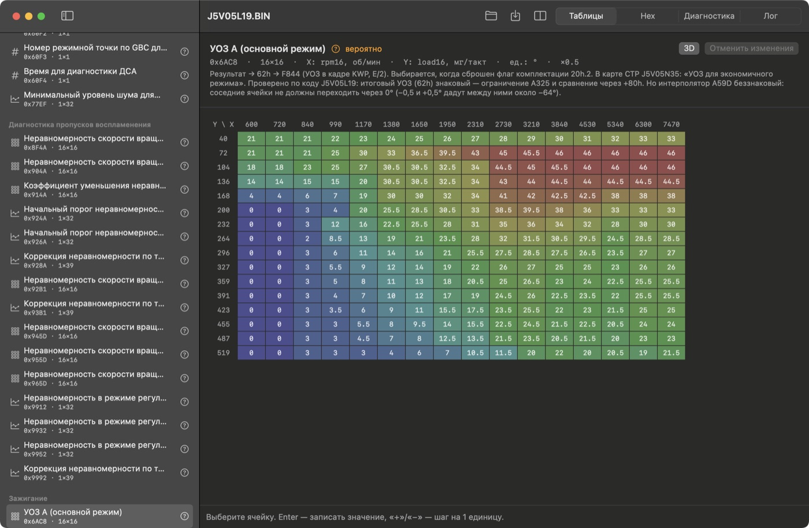
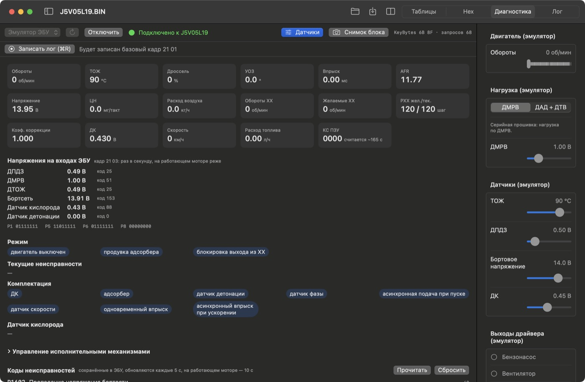
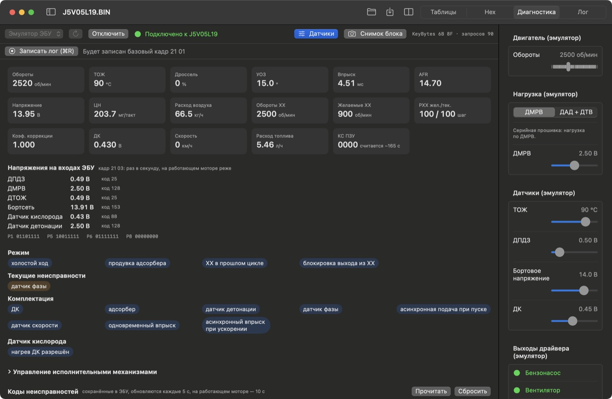
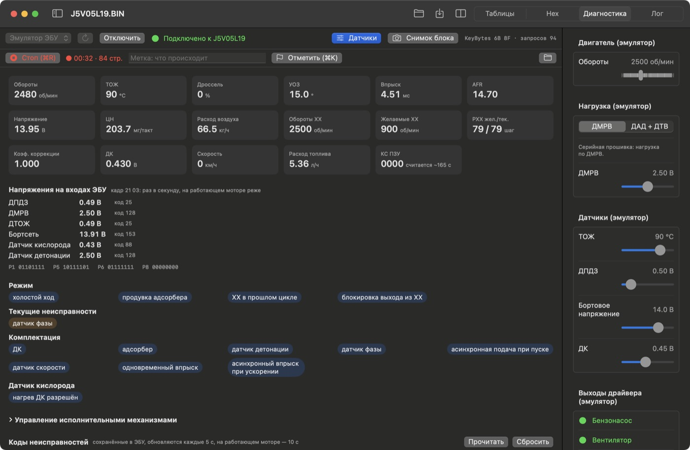
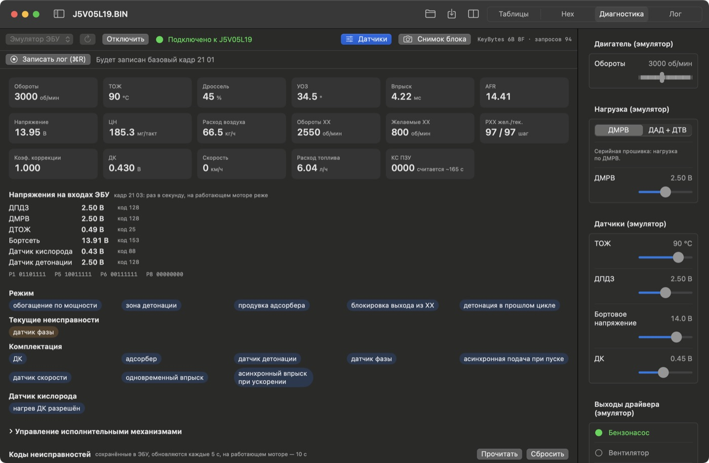
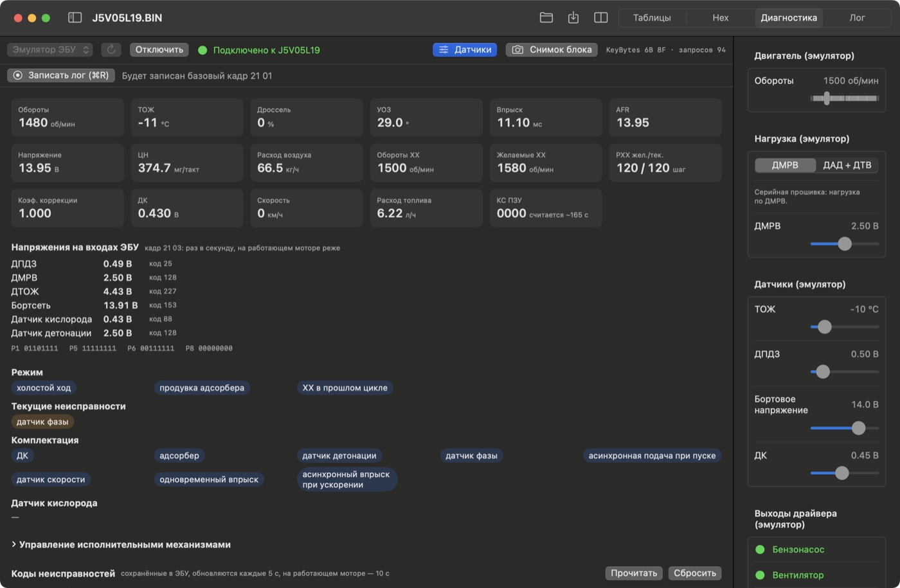
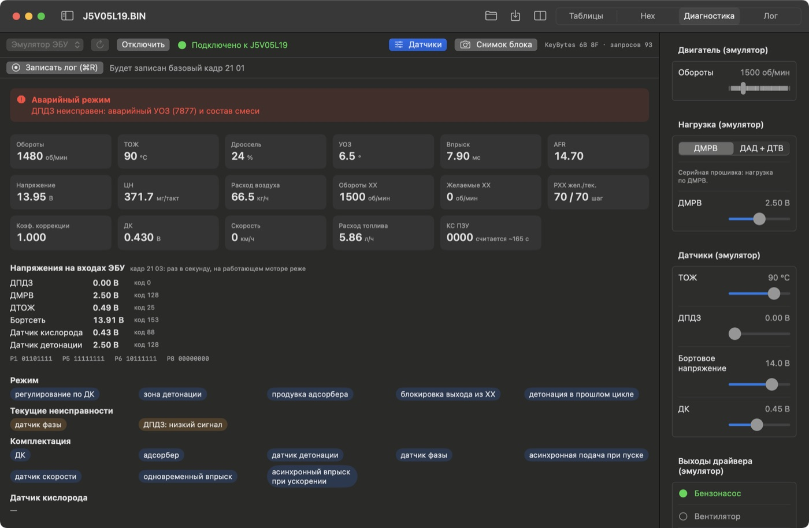
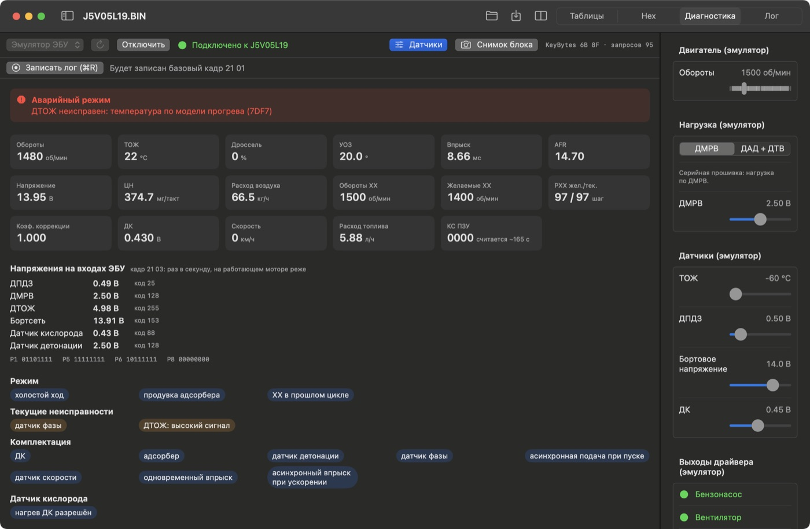
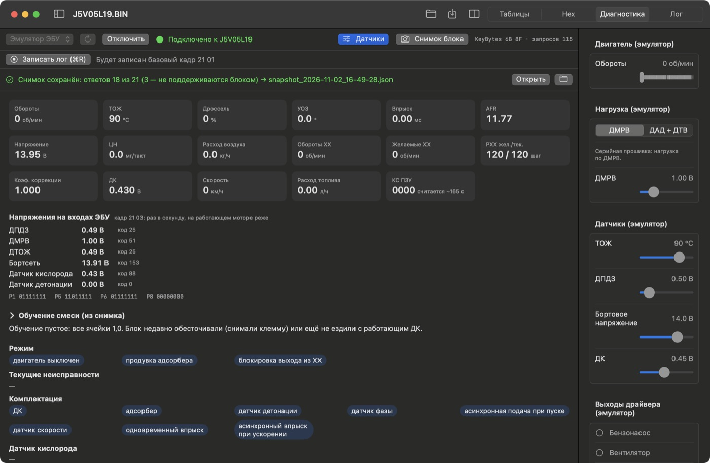

# Урок 1. Диагностика на эмуляторе ЭБУ

**Что получится:** вы подключитесь к эмулятору, «заведёте двигатель», запишете лог и увидите, как прошивка отвечает на изменения датчиков: от обычных режимов до ошибок и аварийного режима. **Время:** около 40 минут. **Машина не нужна.**

> Эмулятор исполняет **настоящий код прошивки** Январь 5.1. Мы задаём только входы — датчики и сигнал коленвала, — а впрыск, УОЗ, режимы и ошибки прошивка считает сама. Физики двигателя нет: давление, расход воздуха и ДК не меняются сами по себе, они такие, как вы выставили.

## 1. Открыть прошивку

Запустите приложение (`tools/run-app.sh`), нажмите «Открыть» (⌘O) и выберите `firmware/j5/j5v05l19/J5V05L19.BIN` — серийную прошивку 2112-41, на которой мы разбирали код.

Слева — список таблиц прошивки, справа — выбранная таблица (здесь — карта УОЗ). Таблицы — тема [урока 3](03-firmware-analysis.md); сейчас переходим на вкладку **«Диагностика»** вверху.

## 2. Подключиться к эмулятору

В списке источников слева вверху выберите **«Эмулятор ЭБУ»** и нажмите **«Подключить»** (⇧⌘D). Около 4 секунд эмулятор «включает зажигание»: прошивка стартует и пытается связаться с иммобилайзером. Затем появится «Подключено к J5V05L19».

Что на экране:

| Блок | Что показывает |
|---|---|
| Плитки вверху | живые параметры из ЭБУ, 3–5 раз в секунду: обороты, ТОЖ, дроссель, УОЗ, впрыск, ЦН (цикловое наполнение) и т. д. |
| Напряжения на входах ЭБУ | напряжение каждого датчика **на выводе ЭБУ**: раз в секунду, на работающем моторе раз в 3 с — то, что блок реально «видит» по проводу (кадр `21 03`) |
| Режим | что сейчас делает прошивка: холостой ход, обогащение по мощности, регулирование по ДК, отсечка… |
| Текущие неисправности | что ЭБУ считает неисправным **прямо сейчас** |
| Комплектация | какие датчики «прописаны» в прошивке |
| Управление исполнительными механизмами | свёрнутый раздел: ручное включение реле и задание ХХ (раздел 9) |
| Коды неисправностей | коды, **сохранённые** в памяти ЭБУ. Обновляются сами каждые 5 с, на работающем моторе — 10 с; «Прочитать» — прочитать сразу, не дожидаясь |
| Кнопка «Снимок блока» | всё, что блок отдаёт на чтение, — в один файл (раздел 10) |
| Панель справа | ползунки — входы эмулятора, внизу — «Выходы драйвера»: какие реле ЭБУ сейчас включил (кнопка «Датчики» прячет панель) |

**Коды, которые эмулятор показывает всегда** — это не ошибка урока:

| Код | Почему |
|---|---|
| P0340 «Ошибка датчика фазы» | эмулятор не подаёт сигнал датчика фазы |
| P1602 «Пропадание напряжения бортсети» | при каждом «включении» память ЭБУ пустая, как после снятия клеммы АКБ |
| P1502 «Цепь реле бензонасоса» | команды реле эмулятор принимает (их видно в «Выходах драйвера»), но сигнал «цепь исправна» от драйвера не моделируется |
| P0505 «Ошибка регулятора ХХ» | появляется, если долго держать обороты на «холостом ходу» (раздел 3): ЭБУ двигает РХХ, а обороты эмулятора от него не зависят |

## 3. «Завести двигатель»

Сдвиньте ползунок **«Обороты»** на 2500. Эмулятор начнёт подавать сигнал датчика коленвала (зубчатый диск 60-2), и прошивка посчитает всё остальное. Подождите 2–3 секунды: прошивка сглаживает показания.

Посмотрите на **«Режим»**: там **«холостой ход»**, хотя обороты 2500. Дроссель 0 % (ДПДЗ 0,5 В — заслонка закрыта), значит, по логике прошивки это холостой ход с высокими оборотами. Желаемые обороты ХХ — 900, а регулятор ХХ (РХХ) в первые секунды закрывается почти полностью (около 20 шагов): ЭБУ пытается сбросить обороты. Ровно так выглядела бы машина с подсосом воздуха или заслонкой, которая не закрывается до упора. Обороты эмулятора от РХХ не зависят, поэтому дальше регулятор «ищет» (на снимке через ~40 с — 100 шагов), а потом ЭБУ записывает P0505.

Обороты 2520, а не 2500: в кадре диагностики обороты передаются с шагом 40 об/мин (бывает и 2480). Так же 13,95 В вместо 14,0 — шаг 0,05 В. Это округление протокола, на машине будет так же.

## 4. Записать лог

Нажмите **«Записать лог (⌘R)»**. Появится красный счётчик времени и строк.

- **Метка** — ⌘K (или впишите текст в поле «Метка» и нажмите «Отметить»). Ставьте метку **перед каждым следующим шагом урока**: «дроссель открыт», «холодный», «ДПДЗ отключён» — в уроке 2 по ним будет легко ориентироваться.
- Лог пишется в «Документы / MacAutoDiag / Logs / <дата_время>_J5V05L19» (в Lite папка называется «MacAutoDiag Lite»): `log.csv` — данные, `log.json` — описание сеанса, метки и коды, `log.kwp.txt` — сырые кадры ЭБУ. Кнопка с папкой открывает её в Finder.

Не останавливайте запись до конца урока.

## 5. Открыть дроссель

Метка «дроссель открыт». Ползунок **«ДПДЗ»** — на 2,5 В (примерно половина хода заслонки), **«Обороты»** — 3000.

| Параметр | Дроссель закрыт, 2500 | Дроссель 45 %, 3000 | Почему |
|---|---|---|---|
| Режим | холостой ход | **обогащение по мощности**, зона детонации | заслонка открыта — режим нагрузки |
| УОЗ | 15° | 34,5° | угол берётся из основной карты УОЗ, а не из регулятора ХХ |
| AFR | 14,7 | 14,4 | при обогащении по мощности смесь богаче |
| ЦН | 204 | 185 | при том же ДМРВ (2,5 В) и большей частоте вращения воздуха на один такт меньше |

Подвигайте **«ДМРВ»** (это нагрузка двигателя): с ростом напряжения растут ЦН и впрыск, а УОЗ уменьшается — при большой нагрузке прошивка уводит угол от детонации. На 3000 об/мин: ДМРВ 1,5 В — ЦН около 37, впрыск 1,6 мс, УОЗ 25–28°; ДМРВ 3,5 В — ЦН около 530, впрыск около 12 мс, УОЗ 10,5°. Строка «ДМРВ» в «Напряжениях на входах ЭБУ» всё время показывает то же напряжение, что на ползунке, — так на машине проверяют сам датчик и провод.

## 6. Холодный двигатель

Метка «холодный». Верните «ДПДЗ» на 0,5 В, «Обороты» — 1500, **«ТОЖ»** — −10 °C.

- **Впрыск** вырос до 11 мс (у тёплого было 4–5): обогащение при прогреве.
- **Желаемые ХХ** — 1580 об/мин (у тёплого 900), РХХ открыт полностью (120 шагов): прогревные обороты.
- В «Напряжениях на входах» ДТОЖ — 4,4 В (у тёплого 0,5 В): холодный датчик — большое сопротивление — высокое напряжение.
- В «Датчике кислорода» пропало «нагрев ДК разрешён»: на холодном ДК не работает.

Это и есть таблицы прошивки в действии: «Обогащение при прогреве по ТОЖ», «Желаемые обороты ХХ по ТОЖ» — их вы увидите в уроке 3.

## 7. Ошибки и аварийный режим

Верните ТОЖ на 90 °C. Ошибки в эмуляторе **не случайные**: одни и те же входы всегда дают одни и те же коды. Вызовем их сами.

### Отказ ДПДЗ

Метка «ДПДЗ отключён». Ползунок **«ДПДЗ» — в 0 В** (как будто отсоединили разъём датчика).

- Через ~1 секунду — «Текущие неисправности: ДПДЗ: низкий сигнал».
- Ещё через пару секунд — сохранённый код **P0122** со значком Check Engine.
- Красная плашка **«Аварийный режим»**: ЭБУ перешёл на аварийную карту УОЗ — угол упал до **6,5°**.
- **«Дроссель 24 %»** при отключённом датчике — это **подставленное** значение, а не положение заслонки. В аварийном режиме процент дросселя в диагностике не верен. Правду показывают «Напряжения на входах ЭБУ»: **ДПДЗ 0,00 В** — по проводу ничего не приходит.

Верните ДПДЗ на 0,5 В: плашка исчезнет, текущая неисправность снимется. **Сохранённый код P0122 останется** — так и на машине: код живёт в памяти, пока его не сбросят. Кнопка «Сбросить» сотрёт коды (приложение спросит подтверждение; в логе останется метка «сброс кодов»).

### Обрыв ДТОЖ

Метка «ДТОЖ обрыв». Ползунок **«ТОЖ» — в −60 °C** (сопротивление огромное — как оборванный провод).

- «ДТОЖ: высокий сигнал», код **P0118**.
- Аварийный режим: **«температура по модели прогрева»** — ЭБУ не верит датчику и показывает около 20 °C, рассчитанные по времени работы; дальше «температура» растёт по часам. Двигатель прогреется «по часам».
- В «Напряжениях на входах» ДТОЖ — **4,98 В, код 255**: вход «упёрся» в 5 В — так выглядит обрыв.

Верните ТОЖ на 90 °C.

### Что попробовать самому

- «Бортовое напряжение» — 9 В: что произойдёт со временем впрыска? (форсунки открываются медленнее — прошивка добавляет время)
- «ДК» — двигайте между 0,1 и 0,9 В при прогретом двигателе на 2000 об/мин с приоткрытым дросселем: смотрите «Коэф. коррекции» — это регулятор по датчику кислорода.
- «ДМРВ» — в 0 В: какие ошибки и какой аварийный режим?

Ответы (проверено на эмуляторе, 3000 об/мин, дроссель 2,5 В, ДМРВ 2,5 В)

- 9 В вместо 14: впрыск вырастает примерно на 0,9 мс (4,3–4,5 → 5,2–5,5 мс) при том же ЦН — добавка на время открытия форсунки по напряжению (таблица «Время задержки открытия форсунки по напряжению»).
- ДК: коэффициент коррекции двигается только в режиме «регулирование по ДК»; при «замороженном» напряжении регулятор уходит к пределу — так и должно быть, когда датчик не отвечает.
- ДМРВ 0 В: «ДМРВ: низкий сигнал», код P0102, аварийный режим «наполнение по дросселю (таблица 726D), аварийный УОЗ» — ЦН считается по положению заслонки и оборотам.

## 8. Остановить запись

Нажмите «Стоп (⌘R)». Папка лога — кнопка с папкой справа. **Этот лог понадобится в [уроке 2](02-log-analysis.md).**

## 9. Ручное управление: включить вентилятор

На машине этим проверяют реле и проводку: блок по команде включает реле, а вы слушаете, щёлкнуло ли оно. В эмуляторе результат видно в панели справа, в «Выходах драйвера».

1. Обороты — 0 (двигатель стоит). На работающем прогретом двигателе вентилятор может быть уже включён самим ЭБУ.
2. Раскройте **«Управление исполнительными механизмами»** → «Разрешить ручное управление…» → «Разрешить». Приложение предупредит: проверять только на стоящей машине.
3. **«Проверить поддержку»**: ЭБУ на 1,5 с зажжёт лампу Check Engine — в «Выходах драйвера» мигнёт «Лампа Check Engine», появится зелёное «Блок принимает команды».
4. У «Реле вентилятора» — **«Вкл»**: в «Выходах драйвера» загорится «Вентилятор». «Выкл» — погаснет.
5. **«Вернуть ЭБУ»** — управление снова у блока. Отключение и обрыв связи тоже возвращают управление сами.

Каждая команда попадает в лог меткой. «Обороты ХХ» в этом же разделе работают на «заведённом» двигателе: задайте 1200 — плитка «Желаемые ХХ» станет 1200.

## 10. Снимок блока и обучение смеси

Нажмите **«Снимок блока»** (вверху справа). За несколько секунд приложение прочитает всё, что блок отдаёт: идентификацию, все кадры, коды, таблицы обучения в памяти, — и сохранит в «Документы / MacAutoDiag / Snapshots» (в Lite — «MacAutoDiag Lite»). Ничего не пишет в блок.

- **«Ответов 18 из 21 (3 — не поддерживаются блоком)»** — так и должно быть: три запроса — расширенные кадры J5LS, серийная прошивка их отклоняет. Отказы тоже сохраняются: что блок не поддерживает — тоже сведения.
- Ниже появится **«Обучение смеси»** — таблица, в которой ЭБУ запоминает поправку топлива по ДК для каждого режима (обороты × нагрузка). Пустая таблица свёрнута, видна только строка вывода, а стрелка у заголовка раскрывает её. В эмуляторе она всегда пустая — все «·» (1,0): память эмулятора стирается при каждом запуске, как после снятия клеммы. На машине оранжевые ячейки — блок добавляет топливо (смесь сама по себе бедная), синие — убавляет.
- **«Открыть»** показывает все ответы с расшифровкой. Там же **«Сравнить с другим снимком…»** — что изменилось между двумя снимками (например, до и после замены датчика): коды, кадры, ячейки обучения.

## Дополнение: прошивка на ДАД + ДТВ

У прошивок под датчик абсолютного давления нагрузку задаёт давление во впуске, а не расход воздуха. Если у вас такая прошивка, в эмуляторе есть переключатель **«ДМРВ / ДАД + ДТВ»** в разделе «Нагрузка»; для J5LS он выставится сам, по флагам комплектации. Больше давление во впуске — больше воздуха в цилиндре — больше топлива и меньше угол. Поэтому неисправный ДАД, «завышающий» давление, даёт переобогащение.
