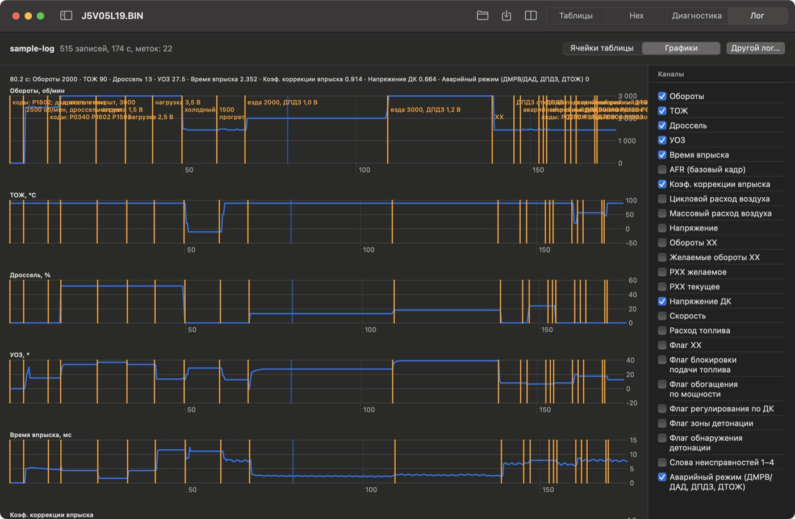
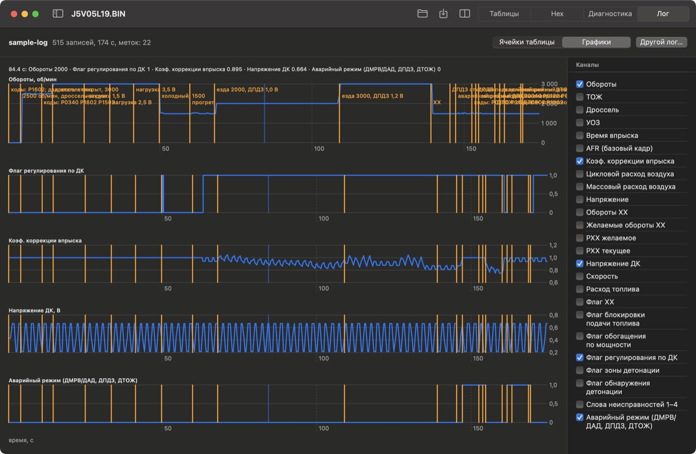
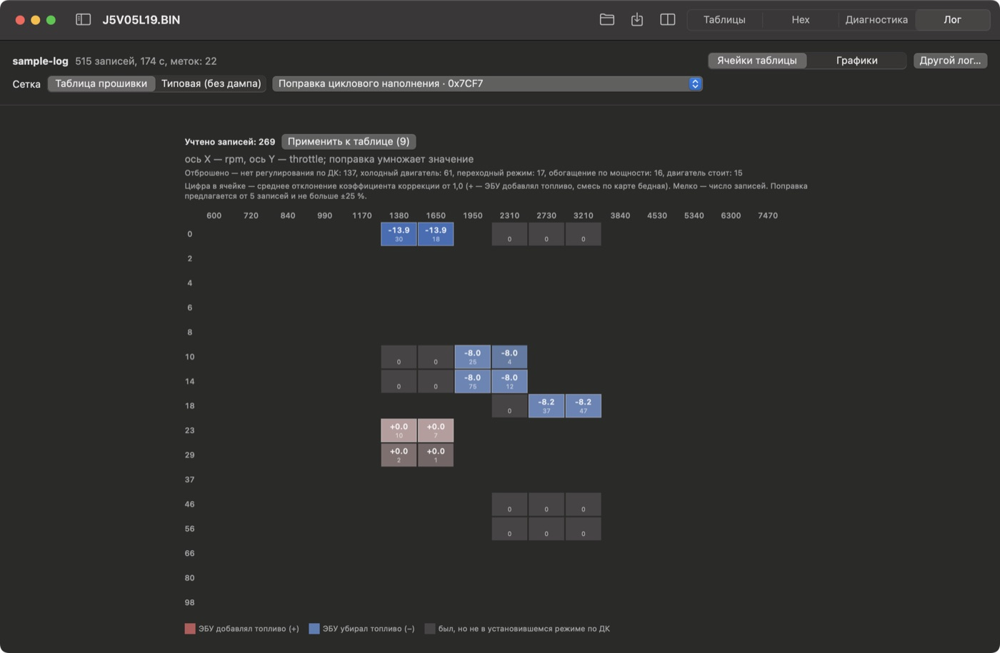
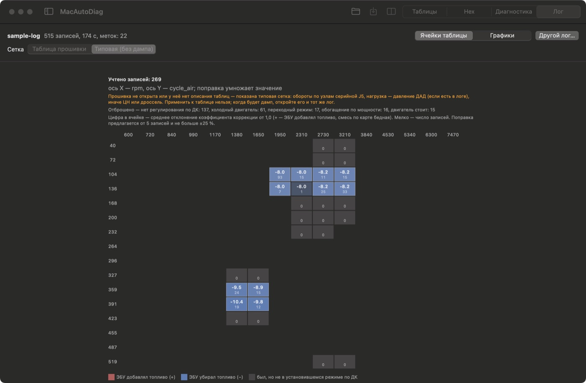

# Урок 2. Разбор лога

**Что получится:** вы откроете лог из [урока 1](01-diagnostics-emulator.md), найдёте на графиках каждое действие, поймёте, что в эти моменты делал ЭБУ, и посмотрите, как приложение считает поправку топливной таблицы по коэффициенту коррекции. **Время:** около 30 минут.

Если урок 1 не проходили — возьмите готовый лог `docs/tutorial/sample-log/` (записан тем же сценарием: 515 строк, 175 секунд, 22 метки).

## 1. Открыть лог

«Файл → Открыть лог для разбора…» (⇧⌘L) или кнопка «Открыть лог…» на пустом экране. Выберите **папку** сеанса из «Документы / MacAutoDiag / Logs» (в Lite — «MacAutoDiag Lite»; или `log.csv` в ней). Откроется вкладка **«Лог»**.

Прошивку открывать не обязательно. Если открыть ту же прошивку, на которой записан лог (`J5V05L19.BIN`), лог можно наложить на её таблицы (раздел 4).

## 2. Графики

Переключатель вверху — **«Графики»**.

- **По графику на канал**, ось времени общая — секунды от начала записи.
- **Оранжевые линии — метки.** Свои (⌘K) и автоматические: «коды: P0122…», «аварийный режим: …», «аварийный режим снят», «обрыв связи». Подписи — на верхнем графике; там, где меток много, они наслаиваются — наведите курсор.
- **Курсор**: наведите мышь на любой график — в строке сверху появятся значения **всех** выбранных каналов в этот момент (на снимке — 80,2 с: обороты 2000, дроссель 13 %, УОЗ 27,5°, впрыск 2,35 мс, коэффициент коррекции 0,914).
- **Каналы** выбираются справа галочками; выбор запоминается.

Пройдите по меткам слева направо и сверьте с тем, что делали в уроке 1:

| Время, с | Метка | Что видно на графиках |
|---|---|---|
| 0–5 | двигатель стоит | обороты 0 |
| 5–15 | 2500, дроссель закрыт | дроссель 0 %, УОЗ ~15° — режим ХХ |
| 15–50 | дроссель открыт, нагрузка 1,5 / 2,5 / 3,5 В | дроссель 52 %; нагрузка 1,5 В — впрыск 1,6 мс, УОЗ 37°; 2,5 В — 4,3 мс, 34°; 3,5 В — 11,5 мс, 13,5° |
| 50–60 | холодный, 1500 | ТОЖ −11 °C, впрыск 11,1 мс (прогревное обогащение) |
| 60–68 | прогрет | ТОЖ 90 °C, на ~63-й секунде включается регулирование по ДК |
| 68–109 | езда 2000, ДПДЗ 1,0 В | дроссель 13 %, УОЗ 27,5°, впрыск 2,2–2,5 мс (его «пилит» регулятор по ДК) |
| 109–139 | езда 3000, ДПДЗ 1,2 В | дроссель 18 %, УОЗ 39°, впрыск 2,5–3,0 мс |
| ~145 | ДПДЗ отключён | дроссель «24 %» (подставное значение), УОЗ 6,5°; через 2 с — метка «аварийный режим», через 7 с — «коды: … P0122» |
| ~160 | ДТОЖ обрыв | ТОЖ «прыгает» на модель прогрева (не на −60 °C, а 20 → 56 °C), аварийный режим, код P0118 |

### Регулирование по датчику кислорода

Оставьте каналы «Обороты», «Флаг регулирования по ДК», «Коэф. коррекции впрыска», «Напряжение ДК», «Аварийный режим».

- **Флаг регулирования по ДК** включается только на прогретом двигателе: через ~3 с после метки «прогрет» (63-я секунда лога). До этого его нет — на холодном ДК не работает.
- С этого момента **коэффициент коррекции** «пилит» вокруг 1,0: ДК показывает «богато» (0,7 В) — ЭБУ убирает топливо, «бедно» (0,2 В) — добавляет. На машине так же, только пила рождается самим двигателем.
- **Аварийный режим** — две «ступеньки» в конце: отказ ДПДЗ и обрыв ДТОЖ. При обрыве ДТОЖ регулирование по ДК на секунду выключается (160,7 с) — ЭБУ увидел «холодный» двигатель.

> **Только в эмуляторе:** ДК здесь переключается по таймеру, а не от состава смеси, поэтому среднее значение коэффициента (и цифры в разделе 4) ничего не говорят о прошивке. На машине среднее отклонение коэффициента в установившемся режиме и есть ошибка топливной карты в этой точке.

## 3. Что ещё можно вытащить из графиков

- **Обороты ХХ / Желаемые обороты ХХ / РХХ** — держит ли ХХ, хватает ли регулятору хода (РХХ на 0 или на максимуме — регулятор «упёрся»).
- **Флаг обогащения по мощности / Флаг блокировки подачи топлива** — когда ЭБУ уходит в мощностной режим и отсечку.
- **Флаг обнаружения детонации** (и для J5LS — откаты УОЗ по цилиндрам) — где двигатель детонирует.
- **Напряжение** — провалы бортсети (при пуске, при включении нагрузки).

## 4. Ячейки таблицы

Переключатель — **«Ячейки таблицы»**. Если открыта прошивка, сетка — **«Таблица прошивки»** и список таблиц с двумя осями.

Как это считается:
1. Каждая запись лога «раскладывается» по 4 соседним ячейкам таблицы — с теми же весами, с какими прошивка сама интерполирует таблицу.
2. Учитываются только **установившиеся режимы с регулированием по ДК на прогретом двигателе**: без отсечки, без мощностного обогащения, без резких движений дросселя и оборотов за последнюю секунду. Остальное отброшено — причины перечислены («нет регулирования по ДК: 137, холодный двигатель: 61…»).
3. В ячейке — **среднее отклонение коэффициента коррекции от 1,0 в процентах** (крупно) и число записей (мелко). **Красное** — ЭБУ добавлял топливо (карта бедная), **синее** — убирал (карта богатая). Серые — двигатель там был, но не в подходящем режиме.
4. **«Применить к таблице»** умножает ячейки (от 5 записей, не больше ±25 %) на средний коэффициент. Правки видны в редакторе таблиц, отменяются кнопкой «Отменить изменения», контрольная сумма пересчитывается при сохранении. Для таблиц состава смеси (AFR) поправка делит значение.

Какую таблицу выбрать: для прошивок с ДМРВ — ту, через которую идёт ошибка подачи (в описании J5 по умолчанию — «Поправка циклового наполнения»); для J5LS на ДАД — «Поправка циклового наполнения (ДАД)» по давлению. Сама «правильная» таблица — решение настройщика; разбор показывает, **где** и **насколько** ЭБУ корректировал.

### Без прошивки — типовая сетка

Закройте прошивку (или откройте лог без неё) — сетка станет **«Типовая (без дампа)»**: обороты по узлам серийной J5, нагрузка — давление ДАД (если оно есть в логе и не всё время 0 — у старой J5LS N35 байты давления нулевые), иначе ЦН.

Применить к таблице нельзя, но картина «где ЭБУ добавлял или убирал топливо» видна сразу — так можно разобрать лог с машины, пока нет дампа её прошивки.

## 5. Файлы лога

| Файл | Что внутри | Чем открыть |
|---|---|---|
| `log.csv` | все каналы, первая колонка — время в мс, последняя — метка | Numbers, Excel, Python |
| `log.json` | начало сеанса, источник, каналы с русскими названиями и единицами, метки, прочитанные коды | любой текстовый редактор |
| `log.kwp.txt` | сырые запросы и ответы ЭБУ байтами | понадобится, если формула параметра окажется неверной — лог можно пересчитать |

## 6. Обучение смеси — без лога

Лог показывает, что делал ЭБУ, пока вы ехали. А **«Снимок блока»** ([урок 1](01-diagnostics-emulator.md), раздел 10) достаёт то, что блок **запомнил** раньше: таблицу обучения смеси. Она похожа на «Ячейки таблицы» — тоже поправка топлива в процентах по ячейкам обороты × нагрузка, — но её копит сам ЭБУ за все поездки, а не одна запись. Оранжевое там совпадает по смыслу с красным здесь: блок добавлял топливо. Хорошая проверка разбора: если лог и обучение в одной зоне показывают одно и то же — картина надёжная.

## Упражнения

1. Найдите на графике момент, когда коэффициент коррекции «отпустило» в 1,0 после регулирования по ДК. Какой флаг в этот момент изменился? *(подсказка: ТОЖ и аварийный режим, около 160 с)*
2. Включите каналы «Желаемые обороты ХХ» и «ТОЖ». Как меняется уставка ХХ при «холодном» участке?
3. Выберите в «Ячейках таблицы» другую таблицу — например, карту УОЗ. Почему картинка ячеек та же, а оси другие? *(ячейки считаются по осям выбранной таблицы — обороты × нагрузка или обороты × ДЗ)*
