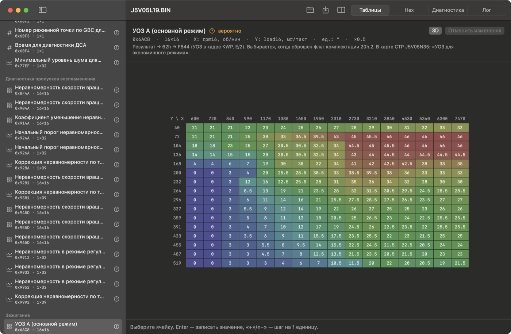
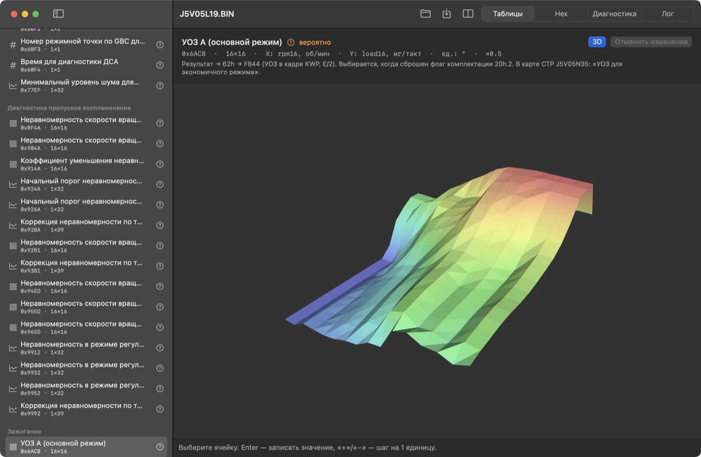
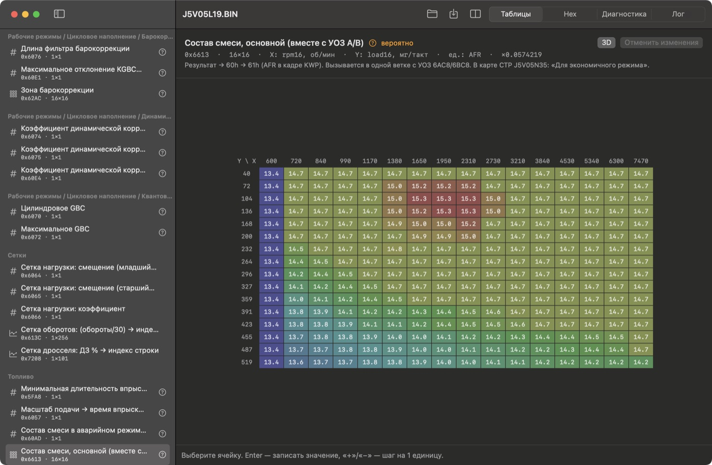
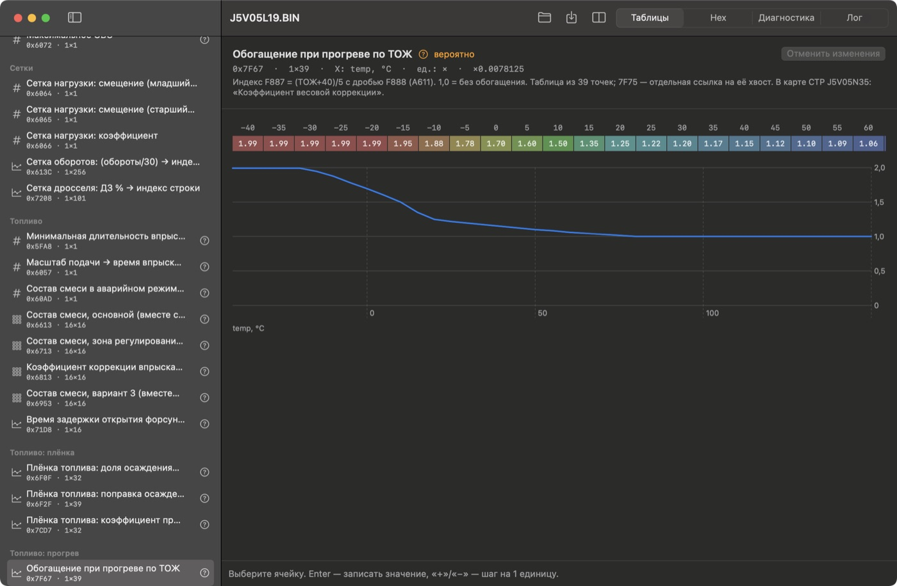
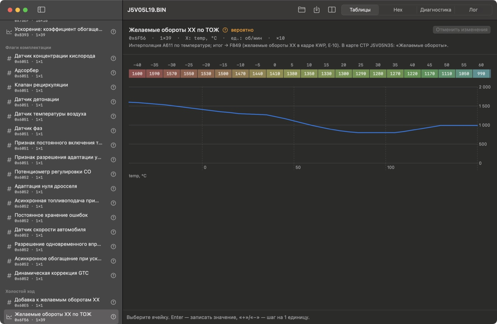
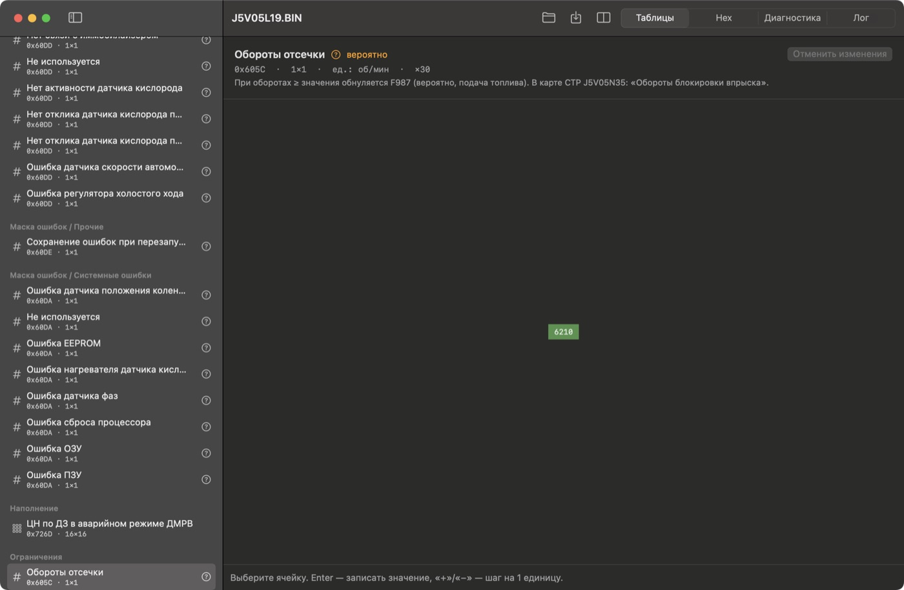
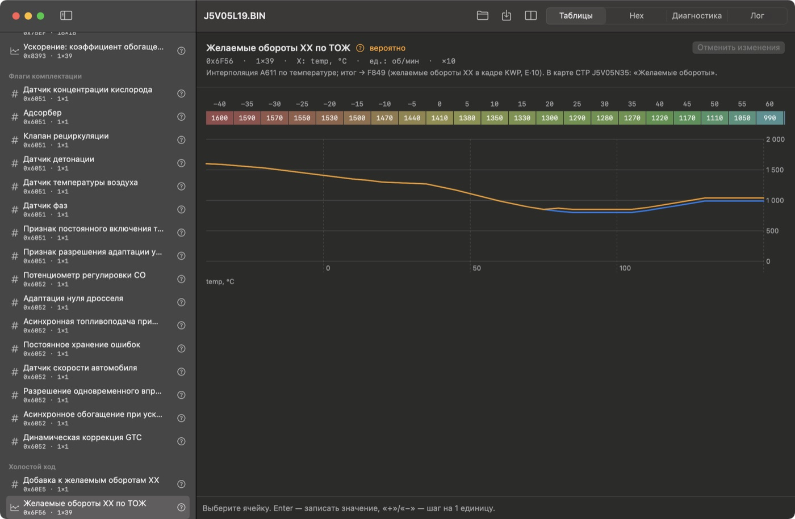

# Урок 3. Разбор прошивки

**Что получится:** вы прочитаете основные таблицы серийной прошивки — карту УОЗ, карту состава смеси, кривые прогрева и ХХ, константы, — поймёте, как они связаны с тем, что вы видели в диагностике, и сравните две прошивки. **Время:** около 40 минут. **Машина не нужна.**

> В этом уроке вы работаете только с **файлом**: в ЭБУ ничего не записывается. Запись в блок — [урок 4](04-flash-emulator.md).

## 1. Открыть прошивку

«Открыть» (⌘O) → `firmware/j5/j5v05l19/J5V05L19.BIN`. Вкладка **«Таблицы»**.

Слева — список: 311 таблиц, флагов и констант, разложенных по группам («Зажигание», «Топливо», «Холостой ход»…). Поиск сверху — по названию или адресу (`6AC8`).

Значок справа от таблицы — насколько мы уверены в описании:

| Значок | Что значит |
|---|---|
| **проверено** (зелёный) | назначение и формула прослежены по коду и на эмуляторе — 8 таблиц |
| **вероятно** (оранжевый) | название по коду прошивки или из карты ChipTuningPRO, на машине не проверено — 288 |
| **назначение неизвестно** | код таблицу читает, но что она значит — не разобрано — 15 |

Под названием таблицы — адрес, размер, оси, единицы и масштаб (`×0.5` — значение = байт × 0,5). Ниже — заметка: откуда известно назначение («Результат → 62h → F844 (УОЗ в кадре KWP)» — значение из этой таблицы попадает в тот УОЗ, что показывает диагностика).

## 2. Карта УОЗ

Таблица **«УОЗ A (основной режим)»** (группа «Зажигание», `0x6AC8`).

- **Столбцы (X)** — обороты, 600…7470 об/мин, 16 точек.
- **Строки (Y)** — нагрузка: цикловое наполнение, 40…519 мг воздуха на такт. Сверху — двигатель почти не нагружен, снизу — полный газ.
- **Ячейка** — угол опережения зажигания, градусы до ВМТ. Между узлами прошивка интерполирует по 4 соседним ячейкам.

Как читать:

| Зона | Значения | Почему |
|---|---|---|
| Малая нагрузка, 2700–7500 об/мин (верхний правый угол) | 44–46° | бедный заряд горит медленно — поджигать нужно раньше |
| Полная нагрузка (нижняя строка), 3000–7500 | 19–22° | плотная смесь горит быстро, большой угол — детонация |
| Полная нагрузка, 600–1400 об/мин | 0–4° | низкие обороты под нагрузкой — самая опасная по детонации зона |

Цвет — от синего (меньше) к красному (больше) **внутри этой таблицы**.

Кнопка **«3D»** показывает ту же карту поверхностью: видна «гора» углов на малой нагрузке и провал к большой.

Угол в диагностике — не прямо ячейка карты. К ней прибавляются поправки: по температуре («Коррекция УОЗ по температуре»), откат по детонации, регулятор ХХ, а в аварийном режиме прошивка берёт отдельную карту «УОЗ в аварийном режиме». Карт УОЗ в группе четыре (A, B, C, D): какая работает, решают флаги комплектации и зона регулирования по ДК.

## 3. Карта состава смеси

**«Состав смеси, основной»** (группа «Топливо», `0x6613`). Те же оси, в ячейке — AFR: сколько килограммов воздуха на килограмм бензина.

| Значение | Где | Что значит |
|---|---|---|
| 14,7 | почти везде | стехиометрия: всё топливо сгорает, катализатор работает |
| 15,0–15,3 (красное) | 1400–2300 об/мин, малая нагрузка | экономичный режим: смесь беднее (CTP называет эту карту «Для экономичного режима») |
| 13,6–14,2 (синее) | нижние строки — большая нагрузка | обогащение по мощности: богаче — больше мощность и холоднее выпуск |
| 13,4 | столбец 600 об/мин | богаче на самых низких оборотах — устойчивее работа |

Меньше AFR — **богаче** смесь. В зоне регулирования по ДК прошивка берёт «Состав смеси, зона регулирования по ДК» и подправляет подачу по датчику кислорода — тот «пилящий» коэффициент коррекции из урока 2.

## 4. Кривые: прогрев и ХХ

Таблица в одну строку с осью — **кривая**: сверху ячейки, снизу график.

**«Обогащение при прогреве по ТОЖ»** (группа «Топливо: прогрев», `0x7F67`) — множитель подачи по температуре двигателя.

- −40…−20 °C — **1,99**: топлива почти вдвое больше. 0 °C — 1,70; 20 °C — 1,25; 50 °C — 1,10; с 80 °C — **1,00** (без обогащения).
- Это и было в уроке 1: на «холодном» (−10 °C) впрыск вырос до 11 мс — коэффициент 1,88 из этой кривой плюс другие прогревные поправки.

**«Желаемые обороты ХХ по ТОЖ»** (группа «Холостой ход», `0x6F56`).

- −40 °C — 1600 об/мин, 0 °C — 1410, 50 °C — 1110, 85–105 °C — **800**.
- Выше 110 °C обороты снова растут до 990 — предположение: при перегреве быстрее крутится помпа.
- Диагностика в уроке 1 показывала другие цифры (900 на прогретом, 1580 при −10 °C): к таблице прибавляются поправки. Какие именно — не разобрано.

Наведите курсор на ячейку — подсказка покажет адрес и **сырой байт** (`0x50 (80)` × 10 = 800 об/мин).

## 5. Константы и флаги

Таблица 1×1 — **константа**. Пример — **«Обороты отсечки»** (группа «Ограничения», `0x605C`): **6210 об/мин**. Выше прошивка прекращает подачу топлива.

Группа **«Датчики»** — тарировки: например, **«Характеристика ДМРВ: напряжение → расход воздуха»** (256 точек; по ней прошивка переводит напряжение ДМРВ в кг/ч).

Группа **«Флаги комплектации»** — отдельные биты: «Датчик концентрации кислорода», «Адсорбер», «Датчик детонации»… Так одна прошивка настраивается под разную комплектацию машины. Группы «Маска ошибок» — какие ошибки прошивка вообще проверяет.

## 6. Правка (только файл)

> **Карты УОЗ правьте так, чтобы соседние ячейки не переходили через 0°.** Угол хранится со знаком, а интерполятор прошивки считает разницу соседних ячеек без знака: между −0,5° и +0,5° блок насчитает около −64°. В серийных картах такого перехода нет (проверено по коду, `docs/ctp-maps.md`).

1. Нажмите на ячейку — внизу появится поле значения.
2. Впишите число и Enter, или «+»/«−» — шаг на один сырой байт (у УОЗ это 0,5°).
3. Изменённые ячейки — **жирные с оранжевой рамкой**. «Отменить изменения» возвращает таблицу как было.
4. «Сохранить как…» (⌘S) пишет **новый** файл и пересчитывает контрольную сумму — без неё ЭБУ не примет прошивку. Исходный файл не меняется.

Правка нужна, чтобы подготовить файл и проверить его на эмуляторе ([урок 1](01-diagnostics-emulator.md)). Записать файл в блок — [урок 4](04-flash-emulator.md).

## 7. Сравнить две прошивки

«Файл → Сравнить с…» (⇧⌘O) — откройте вторую прошивку того же ЭБУ.

- На кривой — **две линии**: синяя — открытая прошивка, оранжевая — сравниваемая. На снимке во второй прошивке подняты обороты ХХ с 80 °C на 50 об/мин.
- В сетке отличающиеся ячейки обведены оранжевым, подсказка ячейки показывает значение «в сравниваемой».
- В списке слева, внизу, — раздел **«Отличия»**: блоки байтов, которые различаются. Нажатие открывает место в Hex.

Так находят, что изменил чужой «чип-тюнинг». Пример из нашей папки: `j5v05l19/J5V05L19.BIN` против `j5v05l19a/J5v05l19a.bin` (контроль ПЗУ отключён) — отличаются всего 15 байт.

### Перенести значения из сравниваемой прошивки

- **«Взять из сравнения»** в заголовке таблицы копирует значения одной таблицы.
- **«Перенести калибровки»** на панели копирует все описанные таблицы, а код прошивки не трогает. Сначала программа спросит подтверждение.

Изменения попадают в открытую прошивку и сохраняются обычным «Сохранить как…». «Отменить изменения» возвращает таблицу как было.

> Переносите только между прошивками одной линии, с одной раскладкой таблиц. **Программа это не проверяет:** ей достаточно, чтобы адрес таблицы умещался в обоих файлах. Перенос между разными линиями запишет значения не в те таблицы.

## 8. Прошивка без описания

Если для прошивки описания нет (например, J5LS), приложение откроет **Hex**, а на вкладке «Таблицы» предложит **карту ChipTuningPRO** (`.j5`) — кнопка «Открыть карту CTP…» или «Файл → Открыть карту ChipTuningPRO…» (⌥⌘M). Названия и формулы тогда берутся из карты, по коду не проверены — приложение об этом предупредит.

## Упражнения

1. Найдите в карте УОЗ ячейку для 2000 об/мин и малой нагрузки. Сравните с УОЗ 27,5° в логе урока 2 на «езде 2000» — почему они могут не совпасть? *(интерполяция между узлами 1950/2310 и поправки по температуре)*
2. Откройте «УОЗ в аварийном режиме» (значок «проверено») и включите 3D. Чем её форма отличается от основной карты? *(на малой нагрузке и высоких оборотах угол не больше 41°, а на большой нагрузке до 1400 об/мин — ноль)*
3. Поднимите обороты отсечки до 6510 (Enter или «+» десять раз), сохраните копию и откройте её сравнением с оригиналом. Сколько блоков в «Отличиях»? *(3: сама константа `0x605C`, контрольная сумма `0xFFFE` и её зеркало `0xFFFA`)*
