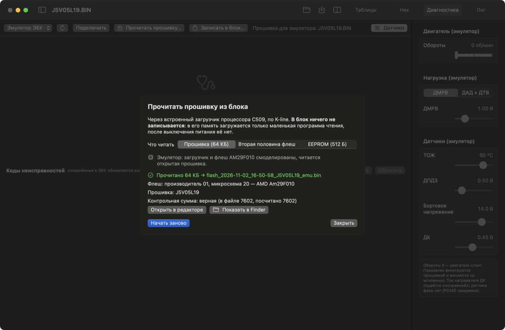
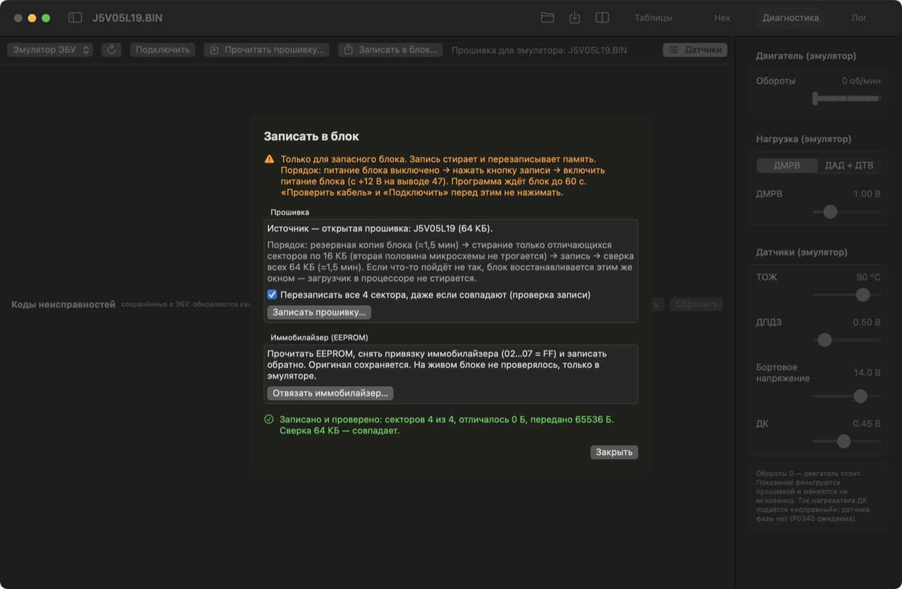
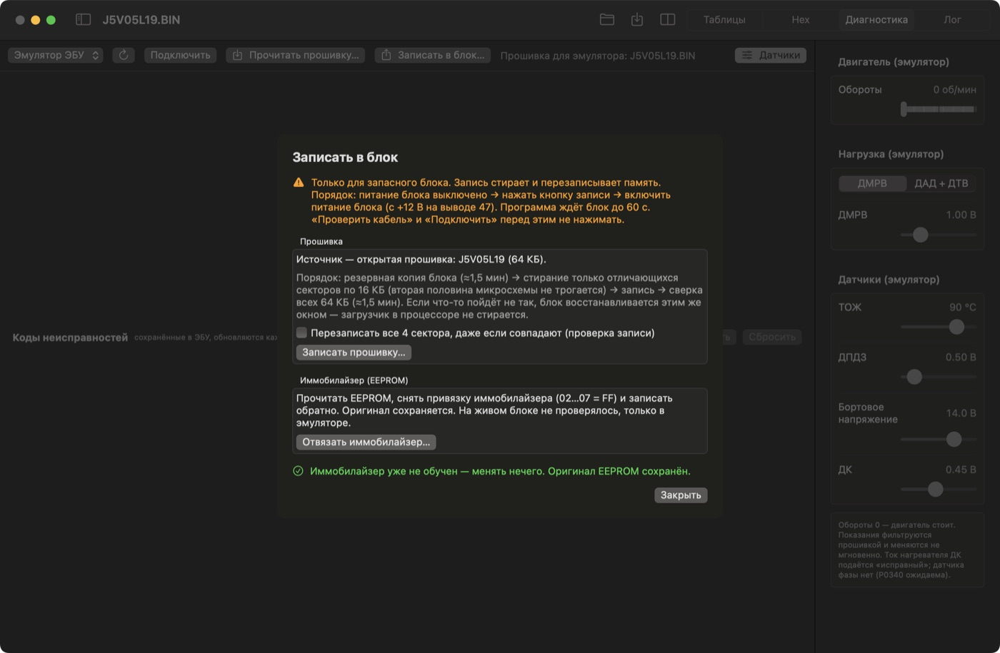
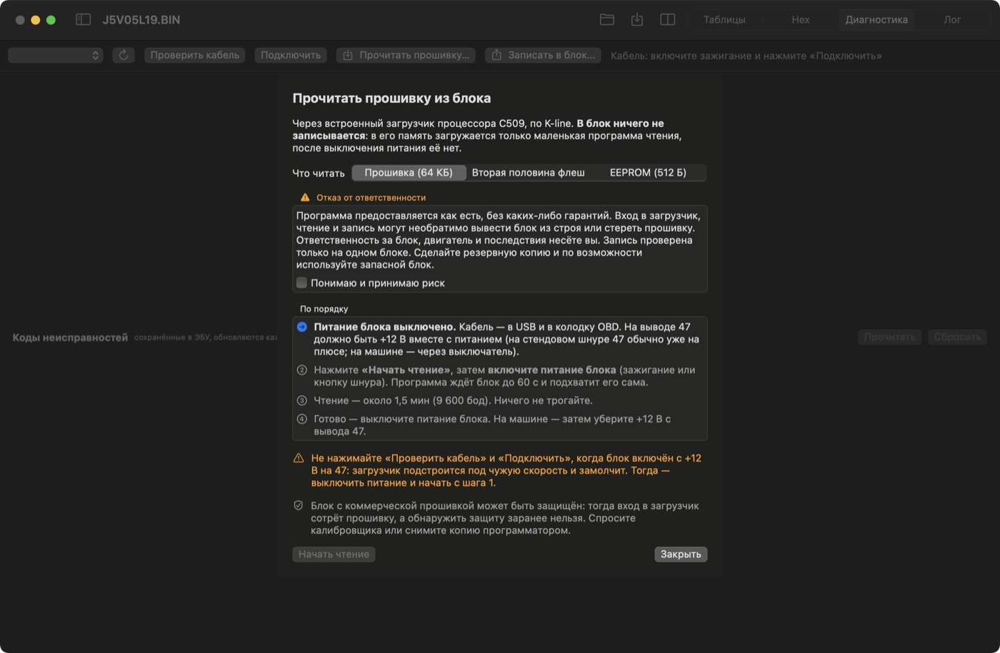

# Урок 4. Чтение и запись блока на эмуляторе

**Что получится:** вы отрепетируете чтение прошивки, запись в блок и отвязку иммобилайзера там, где ошибка ничего не стоит, и узнаете, чем отличается настоящий блок. **Время:** около 25 минут. **Машина и кабель не нужны.**

> **На эмуляторе рисковать нечем.** На настоящем блоке вход в загрузчик, чтение и запись могут необратимо вывести его из строя или стереть прошивку, а ответственность несёте вы. Сначала прочитайте раздел 5.

## 1. Подготовка

Откройте `firmware/j5/j5v05l19/J5V05L19.BIN`, перейдите на вкладку **«Диагностика»**, выберите источник **«Эмулятор ЭБУ»**. **«Подключить»** не нажимайте: кнопки чтения и записи видны только без подключения.

На эмуляторе «в блоке» лежит открытая прошивка. Смоделированы загрузчик процессора и микросхема флеш AM29F010.

## 2. Прочитать прошивку

**«Прочитать прошивку…»** → **«Начать чтение»**. На эмуляторе это занимает несколько секунд, на настоящем блоке — около 1,5 минуты.

| Строка | Что значит |
|---|---|
| Прочитано 64 КБ → файл | образ сохранён в папке данных программы, в `Flash` |
| Флеш: производитель 01, микросхема 20 | код микросхемы AMD Am29F010 |
| Прошивка | идентификатор из образа |
| Контрольная сумма | совпадает ли сумма в файле с посчитанной |

**«Открыть в редакторе»** открывает прочитанный файл как обычную прошивку.

Переключатель вверху окна выбирает, что читать:

- **Прошивка (64 КБ)** — основная половина.
- **Вторая половина флеш** — другие 64 КБ микросхемы. Она занята, например, у двухрежимных блоков.
- **EEPROM (512 Б)** — адаптации и состояние иммобилайзера. Если все байты `FF`, программа предупредит: EEPROM чистая или не ответила.

Рядом с файлом лежит журнал операции `loader_<дата>.log`: каждый шаг с временем. Он пригодится, если что-то пойдёт не так.

## 3. Записать прошивку

Закройте окно чтения. **«Записать в блок…»**.

Так как на эмуляторе в блоке лежит та же прошивка, что открыта, обычная запись сообщит: «Блок уже содержит эту прошивку (0 отличий) — ничего не стёрто и не записано». Чтобы посмотреть весь путь, включите **«Перезаписать все 4 сектора»**, нажмите **«Записать прошивку…»** и подтвердите.

Порядок всегда один:

1. Проверка кода микросхемы. Если это не Am29F010, запись не начнётся.
2. **Резервная копия** блока на диск. Пока её нет, ничего не стирается.
3. Стирание секторов по 16 КБ: только отличающихся, если не включена перезапись всех. Вторая половина флеш не трогается.
4. Запись.
5. **Сверка** всех 64 КБ.

Программа откажется записывать образ, если:

- у него не сходится контрольная сумма: блок показал бы «Ошибка ПЗУ». **Сохраните** прошивку в редакторе, сумма пересчитается;
- в нём есть загрузочный инфо-блок: он отключил бы загрузчик, а это единственный путь восстановления.

## 4. Отвязать иммобилайзер

В том же окне — **«Отвязать иммобилайзер…»**. Программа читает EEPROM, сохраняет оригинал и записывает копию с байтами `02…07 = FF`.

EEPROM эмулятора пустая, поэтому здесь вы увидите: «Иммобилайзер уже не обучен — менять нечего». Сам путь с обученным иммобилайзером проверен автоматическими тестами на эмуляторе. **На живом блоке отвязка не проверялась.**

## 5. Что меняется на настоящем блоке

С выбранным портом кабеля окна выглядят иначе: появляются порядок действий и **отказ от ответственности**. Пока не поставлена галочка «Понимаю и принимаю риск», кнопки неактивны.

1. **Сначала выясните, нет ли защиты.** Блок с коммерческой прошивкой может быть защищён: тогда вход в загрузчик, даже только для чтения, сотрёт прошивку, а заранее это по K-line не узнать. Спросите калибровщика. На таком блоке этим окном не пользуйтесь.
2. **Первые записи — только на запасном блоке.** Запись проверена на одном блоке, `2112-1411020-41`.
3. **Подключение:** нужен кабель KKL и +12 В на выводе 47 вместе с питанием блока. На машине — через выключатель. Распиновка — `docs/j5-hardware.md`.
4. **Порядок важен:** питание блока выключено → кнопка в программе → включить питание. Программа ждёт блок до 60 с.
5. **Не нажимайте «Проверить кабель» и «Подключить»**, когда на выводе 47 есть +12 В: загрузчик подстроится под чужую скорость и замолчит. Тогда выключите питание и начните сначала.
6. **Время:** чтение — около 1,5 минуты, запись со сверкой — около 4 минут. Ничего не трогайте, питание не отключайте.
7. **После работы:** выключите питание и уберите +12 В с вывода 47.

**Если запись прервалась:** блок не запустится, но загрузчик находится в процессоре и не стирается. Выключите питание и повторите запись тем же окном, источник — резервная копия. Это верно для блока без защиты.

Подробности — `docs/flashing.md`.

## Упражнения

1. Запишите прошивку без «Перезаписать все 4 сектора». Что сообщит программа и почему? *(0 отличий: в эмуляторе лежит открытая прошивка)*
2. Измените ячейку в таблице, не сохраняя файл, и откройте окно записи. Что случится с кнопкой? *(неактивна: контрольная сумма не сходится, причина написана красным)*
3. Прочитайте EEPROM. Что программа говорит об иммобилайзере? *(не обучен, все байты `FF`: EEPROM эмулятора пустая)*
